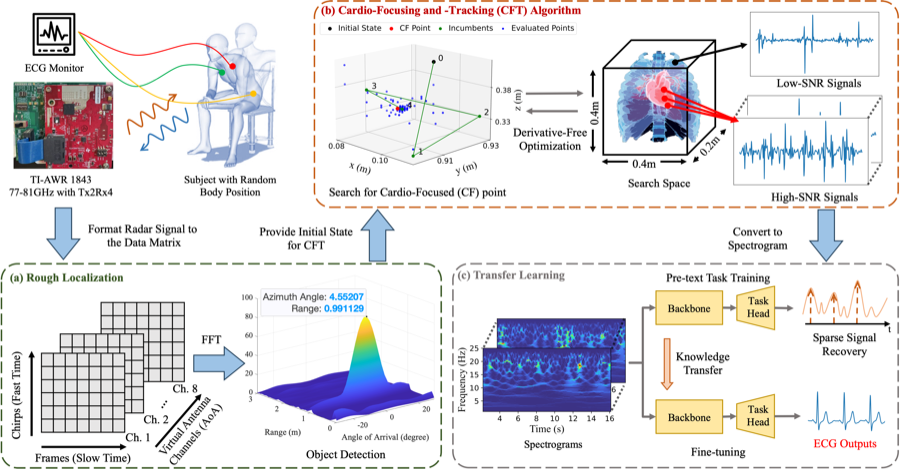
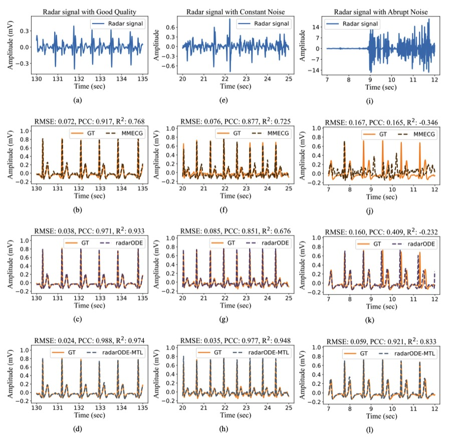
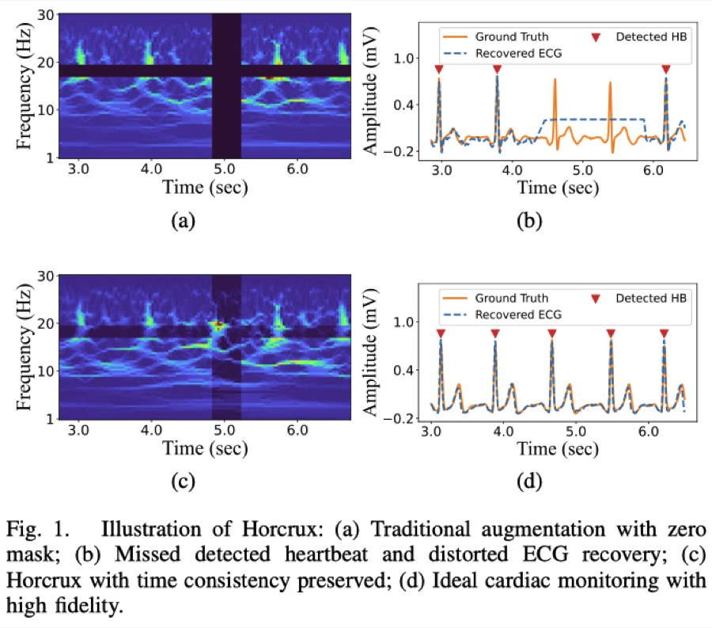
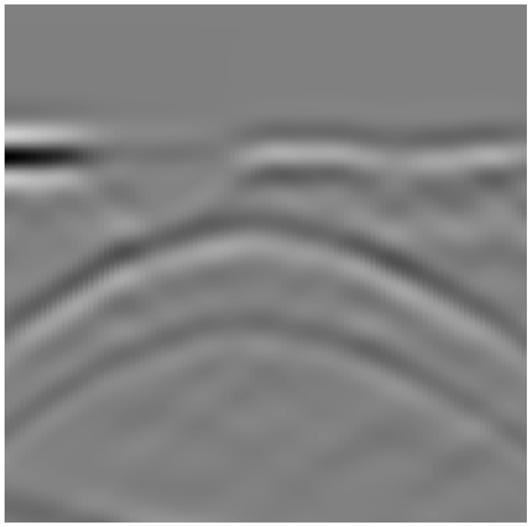

# Research

## Physical AI for Health

I study how models of physiology and sensor physics can guide deep learning for unobtrusive cardiovascular monitoring. In radarODE, a differentiable model of ECG morphology guides the reconstruction of cardiac waveforms from radar. In my work on bodyseismography, I model how a heartbeat propagates through the body and bed to explain the vibrations measured along three axes.

[Cardiac Mechanics and Bed Vibrations](https://arxiv.org/abs/2610.35844) · [Physics-Constrained Blood Pressure Estimation](https://arxiv.org/abs/2608.23562)

## Time-Series Modeling

In collaboration with researchers at Kyushu University, I study [state-space models for forecasting](https://doi.org/10.1016/j.engappai.2026.115625) and [feedback control for glucose monitoring](https://doi.org/10.1016/j.neunet.2026.109893).

## Open-Source Projects

TMC 2026

**[CFT-RFcardi](https://github.com/ZYY0844/CFT-RFcardi)**

A **cardio-focusing + transfer-learning** pipeline that learns ECG recovery from a small set of high-SNR radar signals and transfers to limited-data regimes. Released with a ready-to-run pre-processed dataset for quick validation.

[**Paper**](https://ieeexplore.ieee.org/document/11216086) &nbsp; · &nbsp; [**Code**](https://github.com/ZYY0844/CFT-RFcardi) &nbsp; · &nbsp; [**Dataset**](https://drive.google.com/file/d/1i0lZghlh_cT6JN0vsXCl66FX0eeETEfs/view?usp=sharing)

TMC / TIM 2025

**[radarODE-MTL](https://github.com/ZYY0844/radarODE-MTL)**

A multi-task learning framework with **eccentric gradient alignment** for robust radar-based ECG reconstruction. The repository implements both *radarODE* (IEEE TMC 2025) and *radarODE-MTL* (IEEE TIM 2025), decomposing long-term cardiac activity into individual cycles and leveraging an ODE decoder for noise robustness under body motion.

[**Paper (radarODE)**](https://arxiv.org/abs/2408.01672) &nbsp; · &nbsp; [**Paper (radarODE-MTL)**](https://arxiv.org/abs/2410.08656) &nbsp; · &nbsp; [**Code**](https://github.com/ZYY0844/radarODE-MTL)

EMBC 2025 · Oral

**[Horcrux](https://github.com/ZYY0844/Horcrux)**

A **spectrogram-component augmentation** method for cardiac feature monitoring from radar signals. Horcrux splits a spectrogram into time-consistent components and re-combines them to enlarge effective training data, plug-and-play for any radar-spectrogram pipeline.

[**Paper**](https://embc.embs.org/2025/) &nbsp; · &nbsp; [**Code**](https://github.com/ZYY0844/Horcrux)

Toolkit

**[GPR-B-scan-dataset-generator](https://github.com/ZYY0844/GPR-B-scan-dataset-generator)**

A synthetic **B-scan dataset generation toolkit** for training neural networks on ground-penetrating radar imagery, built on top of [gprMax](https://github.com/gprMax/gprMax). Used in my undergraduate thesis on buried-object detection with CNNs.

[**Code**](https://github.com/ZYY0844/GPR-B-scan-dataset-generator)

